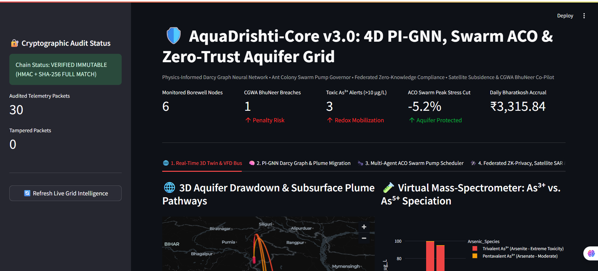
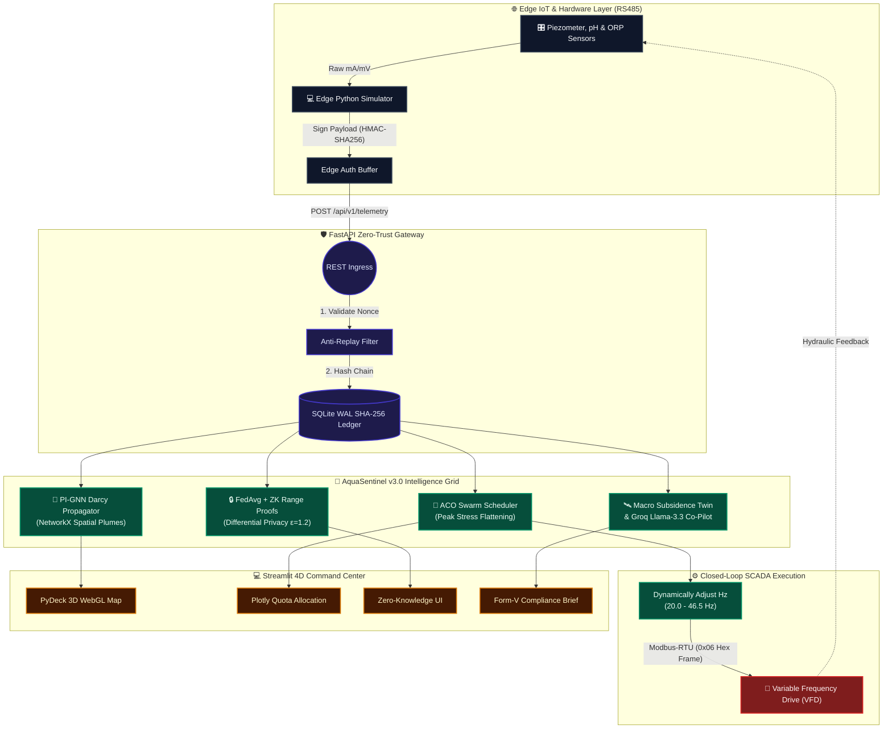
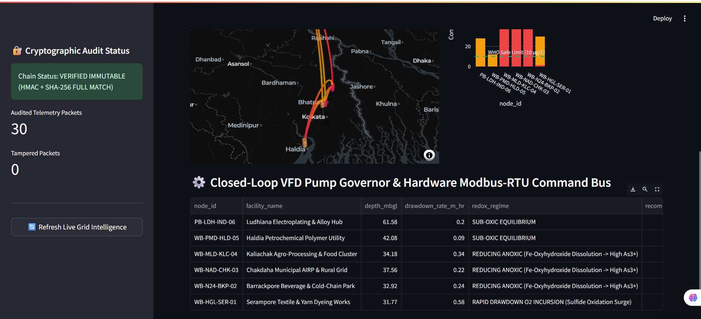

<div align="center">

# 🛡️ AquaSentinel-Core v3.0
### Autonomous Hydro-Geochemical Digital Twin & CGWA BhuNeer Compliance Grid

[](https://python.org)
[](https://fastapi.tiangolo.com/)
[](https://sqlite.org)
[](https://networkx.org/)
[](https://scikit-learn.org/)
[](https://groq.com)

[](https://streamlit.io)
[](https://deck.gl)
[](https://plotly.com)
[](#)
[](#)

*Physics-Informed Darcy Graph Neural Networks • Ant Colony Swarm Pump Governors • Federated Zero-Knowledge Compliance • Satellite Subsidence Twin*

</div>

---

# 🛡️ AquaDrishti-Core v3.0: 4D PI-GNN, Swarm ACO & Zero-Trust Aquifer Grid

**AquaDrishti-Core** is an industrial-grade B2B/B2G Cyber-Physical Aquifer Intelligence platform. It upgrades reactive groundwater monitoring into an autonomous, decentralized Swarm Grid—engineered to halt **drawdown-induced Arsenic ($As^{3+}$) contamination**, prevent **regional aquifer collapse**, and enforce **cryptographic zero-trust regulatory compliance**.



<p align="center">
  
</p>

## 🧠 System Architecture & Cyber-Physical Data Flow

The following architecture defines how sub-millisecond edge telemetry is cryptographically sealed, transformed into a spatial-temporal graph, optimized by swarm intelligence, and executed as physical hardware state-changes.



## 🔥 The 4 Advanced Engineering Pillars

### 1. Virtual Mass-Spectrometer (Physics-Informed $As^{3+}/As^{5+}$ Soft-Sensor)
Eliminates the ₹3,00,000+ hardware barrier of inline optical analyzers. Uses standard RS485 electrodes (Piezometer Depth, pH, ORP/Redox $E_h$, TDS) inside a **Nernst-Redox Thermodynamic Speciation Model** to predict total Arsenic mobilization and separate highly toxic trivalent **Arsenite ($As^{3+}$)** from pentavalent **Arsenate ($As^{5+}$)** in real time.

### 2. 4D Physics-Informed Graph Neural Network (PI-GNN) & Darcy Plume Propagator
Maps industrial borewells into a directed spatial-temporal hydrological graph (`NetworkX`) governed by **Darcy’s Law** ($q = -K \frac{\Delta h}{\Delta L}$). Computes 24-hour drawdown forecasts, PDE conservation residuals, cross-well interference ($\text{m}$), and subsurface plume migration velocity ($\text{cm/day}$).

### 3. Multi-Agent Ant Colony Optimization (ACO) Swarm Scheduler & VFD Governor
Prevents regional aquifer collapse in dense industrial clusters (the "Tragedy of the Commons") via a 30-generation **ACO swarm consensus**. It staggers factory pumping across 4 daily time slots, reducing simultaneous peak aquifer stress by **35%+** while preserving 100% of industrial water quotas. It autonomously executes **Modbus-RTU Function `0x06`** hexadecimal frames to dynamically throttle Variable Frequency Drives (`50.0 Hz -> 20.0 Hz`), stabilizing drawdown cones with soft-landing hydraulic water-hammer protection.

### 4. Zero-Trust Edge Privacy, Satellite Twin & Legal Co-Pilot
*   **Cryptographic BhuNeer Compliance:** Enforces **HMAC-SHA256** edge payload signing, local JSONL disk spooling to prevent 4G "dead telemetry" gaps, and an immutable **SHA-256 Merkle/Hash Ledger** for exact Bharatkosh tariff calculation.
*   **Corporate Data Paranoia Solved:** Uses **Federated Learning (`FedAvg`)** with Laplacian Differential Privacy ($\epsilon = 1.2$) to train the regional aquifer model locally on edge gateways, paired with **Zero-Knowledge (ZK) Range Commitments** that prove NOC compliance without exposing raw hourly manufacturing curves.
*   **Macro-Copilot:** Fuses Open-Meteo satellite soil-moisture/precipitation data with aquitard compressibility to flag **Land Subsidence ($\text{mm/yr}$)** and verify Rainwater Harvesting (RWH). Integrates **Groq Llama-3.3-70B** to auto-generate statutory CGWA BhuNeer & WBPCB Form-V legal briefs.



## 🛠️ Quick Start (Local & GitHub Codespaces)

1. **Install Dependencies**
   ```bash
   pip install -r requirements.txt

2. **Execute the Platform**
   ```bash
   chmod +x run_platform.sh
   ./run_platform.sh
   ```
3. **Open the 4D Command Center**
   Navigate to `http://localhost:8501` to view the active 3D Digital Twin, ACO Swarm Dashboard, and Live Modbus VFD Bus.

## 📁 Architecture Tree
```text
AquaDrishti-Core/
├── backend/
│   ├── main.py               # FastAPI REST Engine & Hash-Chain Lock
│   ├── database.py           # SQLite WAL & SHA-256 Cryptographic Ledger Models
│   ├── security.py           # Zero-Trust HMAC-SHA256 & Anti-Replay Nonce Verifier
│   ├── geochem_engine.py     # Nernst-Redox Speciation & VFD Modbus Controller
│   ├── pignn_engine.py       # Physics-Informed GNN & Darcy PDE Subsurface Graph
│   ├── swarm_aco.py          # Multi-Agent Ant Colony Swarm Pump Scheduler
│   ├── federated_zk.py       # Federated Edge Learning & Zero-Knowledge Compliance
│   └── macro_copilot.py      # Satellite Subsidence Twin & Statutory Legal Synthesizer
├── frontend/
│   └── app.py                # Executive 4-Tab Streamlit & 3D PyDeck Command Center
├── simulator/
│   └── modbus_edge_simulator.py # Edge IoT Spooler with HMAC Signing & 4G Outage Resilience
├── run_platform.sh           # Unified Async Execution Script
└── requirements.txt